<div align="center">

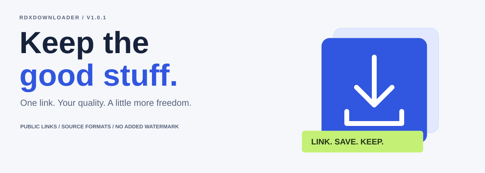

<br>


### One link. Your quality. A little more freedom.

**v1.0.1 update:** [Fix the Termux/Git error and start the backend →](docs/TERMUX.md)

A considered, open-source way to save **authorized public videos** in source-available qualities.<br>
A modern frontend. A real Python backend. No added watermark. No downloader-overlapping ads.

[Get started](#-start-here) · [Deployment guide](docs/DEPLOYMENT.md) · [Ad setup](docs/ADVERTISING.md) · [Release helper](docs/RELEASING.md) · [Architecture](docs/ARCHITECTURE.md)

</div>

> **The honest version:** This is not an “any URL from any platform” promise. Download only content you own or are permitted to save. Private/login-only sources, DRM, live streams, playlists and unsupported platforms are not bypassed. Source watermarks may remain. The named platform link families are recognized, not universally guaranteed. Resolutions, codecs and sound depend on the source.

## ◇ A quieter kind of downloader

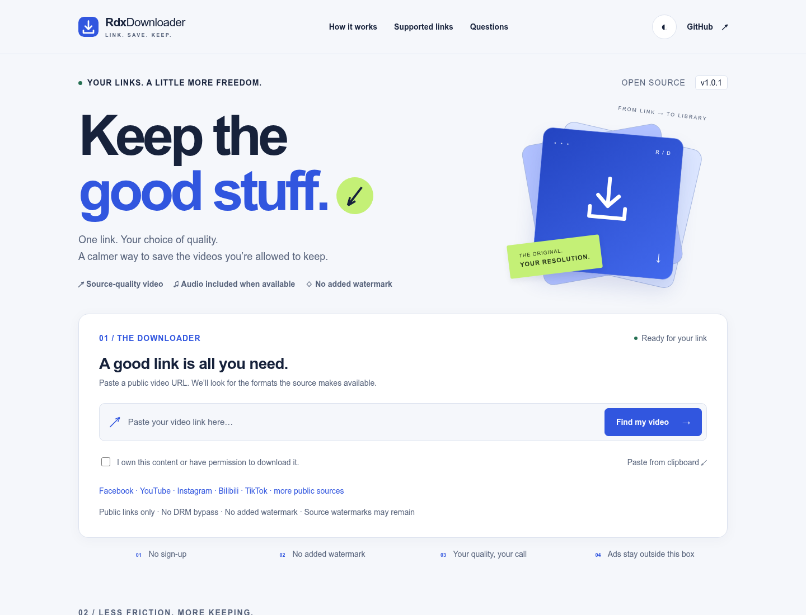

<table>
<tr>
<td width="50%">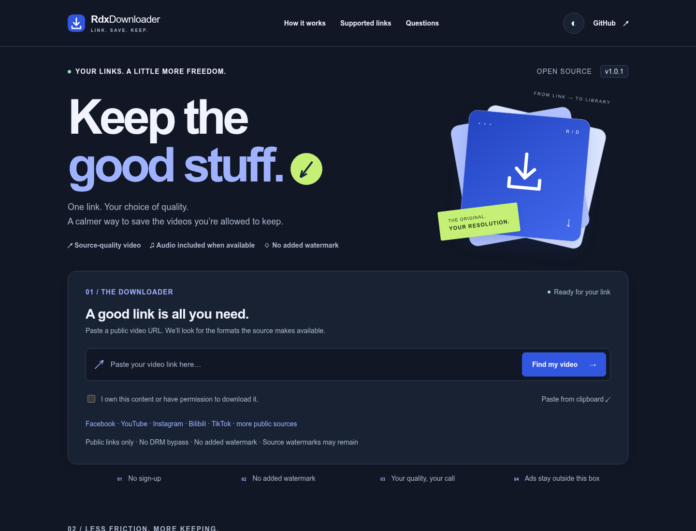</td>
<td width="50%">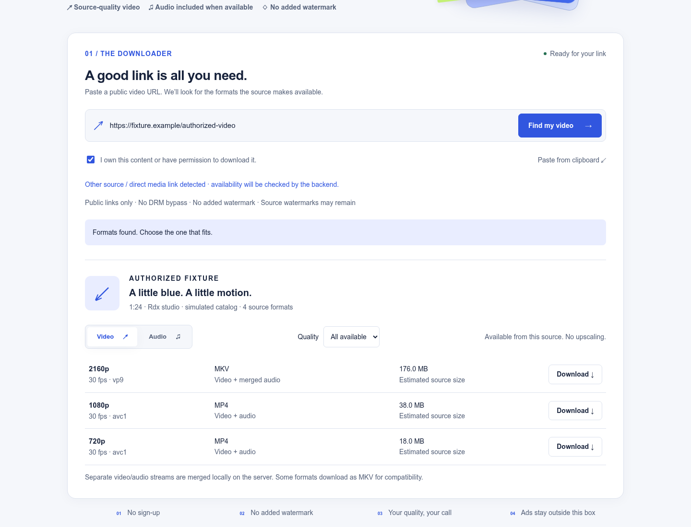</td>
</tr>
<tr><td align="center"><b>After dark.</b> Follows the OS, with a manual theme switch.</td><td align="center"><b>Only what exists.</b> Source formats, not invented quality buttons.</td></tr>
</table>

Screenshots demonstrate UI states. Format/progress previews use simulated metadata; they do not claim those qualities exist for a particular public URL. No live ads or third-party videos were requested for UI screenshots.

## ↘ Link → choose → keep

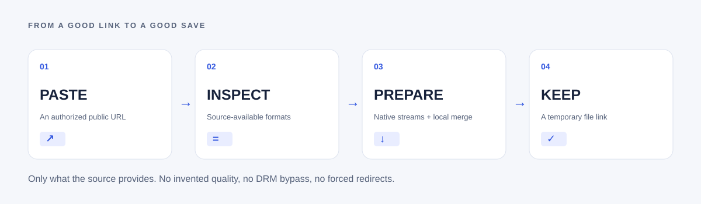

| What you get | What it actually means |
|---|---|
| **Source-available video qualities** | Eligible formats are derived from yt-dlp metadata; no upscaling or fake 4K. |
| **Video with sound when available** | Original audio is included or native streams are locally merged with FFmpeg. |
| **No added watermark** | This project adds no branding to your media; it does not remove embedded source watermarks. |
| **Original audio formats** | Audio-only M4A/WebM/Opus/etc. when exposed, not everything mislabeled as MP3. |
| **A genuinely responsive tool** | Video/audio tabs, clipboard input, progress, error states, light/dark themes, keyboard support. |
| **No sign-up in this starter** | Temporary random bearer download links, not a permanent personal library. |
| **Ads with boundaries** | Twelve manual placement positions, all outside the protected downloader section. |
| **A real backend** | Self-hosted Python + yt-dlp + FFmpeg; no hidden paid downloader API. |

## ▤ Made for the small screen, too

<table>
<tr>
<td width="33%">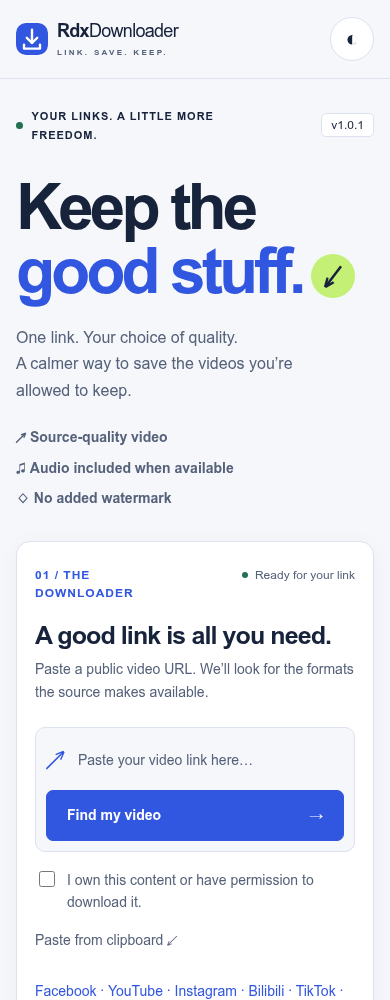</td>
<td width="33%">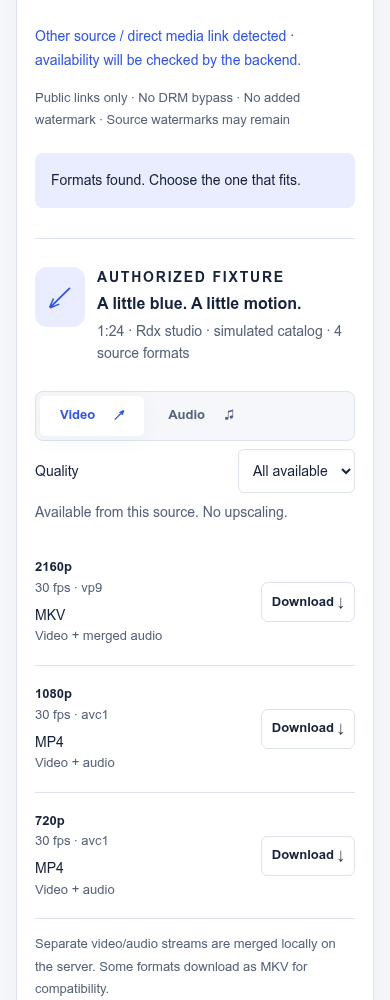</td>
<td width="33%">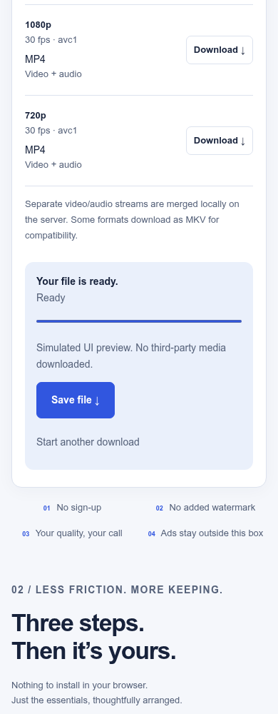</td>
</tr>
<tr><td align="center"><b>Paste.</b></td><td align="center"><b>Pick.</b></td><td align="center"><b>Keep.</b></td></tr>
</table>

No sticky ad bars, click traps or forced navigation are installed. No third-party browser extension is required. The host still needs appropriate capacity, HTTPS, legal notices and abuse handling.

## ↗ What changed in v1.0.1

- Safe snapshot publishing fixes ZIP/local-history mismatch without rewriting GitHub history.
- Native 64-bit Termux setup, HOME-based runtime, portable temporary directory, and a `start` command.
- Deno + matched bundled EJS support for fuller YouTube extraction; no request-time component downloads.
- Facebook, YouTube, Instagram, Bilibili and TikTok link hints, source-specific errors and best-effort direct public media.
- Compatible H.264/AAC pairs merge to MP4; other combinations retain suitable MKV output.
- Real resolution filtering, backend URL settings and visible missing-tool diagnostics.

[Termux and update fix →](docs/TERMUX.md) · [Offline doctor →](scripts/doctor.py)

## ⚡ Start here

### Recommended: one container, one origin

```bash
git clone https://github.com/Hriduan/RdxDownloader.git
cd RdxDownloader
cp .env.example .env
docker compose up --build -d
```

Open **http://127.0.0.1:8080** locally. For a public site, place the container behind an HTTPS reverse proxy or a container host’s HTTPS endpoint. Review [the production checklist](docs/DEPLOYMENT.md#6-before-public-launch) before inviting traffic.

### Or run Python directly

```bash
python -m venv .venv
source .venv/bin/activate       # Windows: .venv\Scripts\activate
pip install -r requirements.txt
# Install FFmpeg with your OS package manager first.
python -m server.app
```

**Requirements:** Python 3.11+, FFmpeg/ffprobe, yt-dlp with its matching EJS package, Deno for fuller YouTube support, sufficient temporary disk and lawful HTTP(S) access to the requested source. Default limits: 512 MiB file, 30-minute known video duration, 20-minute job runtime and two workers. Host limits are configurable.

### Can I just upload it to GitHub Pages?

**The interface, yes. The downloader backend, no.** GitHub Pages cannot execute Python/FFmpeg or prepare video files. Use either:

- a Docker-capable host for the whole app; or
- GitHub Pages for the frontend **plus** the separately deployed HTTPS backend.

For Pages, set repository variable `RDX_API_BASE_URL`, allow the frontend’s exact origin on the backend, and run the manual Pages workflow. [Full steps →](docs/DEPLOYMENT.md#3-optional-github-pages-frontend)

The source is free to use. Hosting, bandwidth and storage are not guaranteed free.

## ◫ Plenty of ad capacity. A protected workspace.

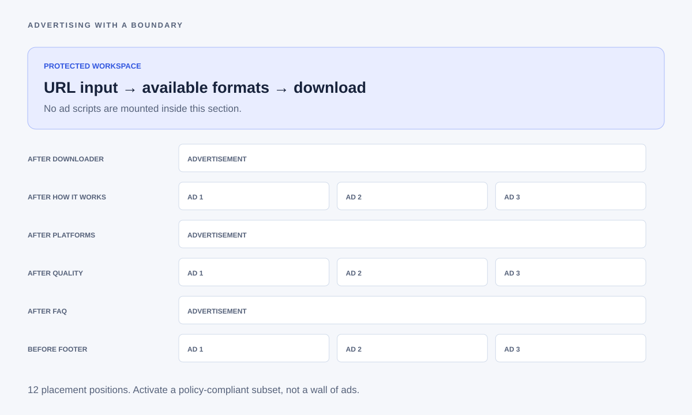

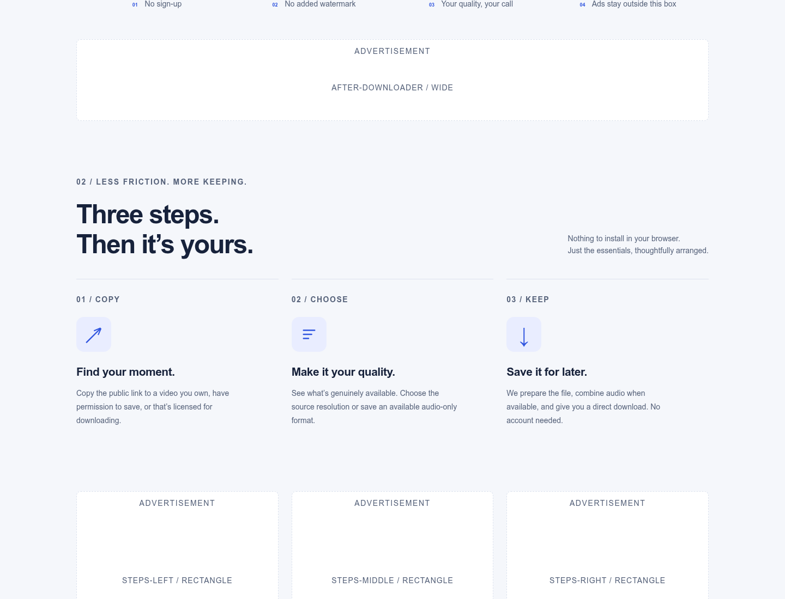

**Both Google AdSense and Adsterra are supported, but disabled by default.** The new domain and its approved placement codes have not been supplied. This project does not copy TechnoGalaxy-only Adsterra keys or invent publisher IDs.

1. Open the site with `?adpreview=1` to inspect all 12 layout reservations. This makes **zero live ad requests**.
2. Register the new domain with the providers and obtain real approved display/native tags.
3. Edit `assets/js/ads-config.js`; configure a conservative subset first.
4. Publish the required genuine Google CMP/Privacy & messaging setup and your actual `ads.txt` records.
5. Keep Auto ads, sticky overlays and popunders disabled to maintain strict workspace separation.

The local choices panel is not a certified CMP. Consent rejection and browser privacy signals are respected. Ad approval, actual fill, revenue and legal compliance are not guaranteed. Utility sites and excessive ad-to-content ratios can be ineligible under provider policies. **Twelve positions are capacity, not an instruction to saturate the page.**

[Placement IDs, snippets, consent behavior and provider checklist →](docs/ADVERTISING.md)

## ⌘ Organized from the first file

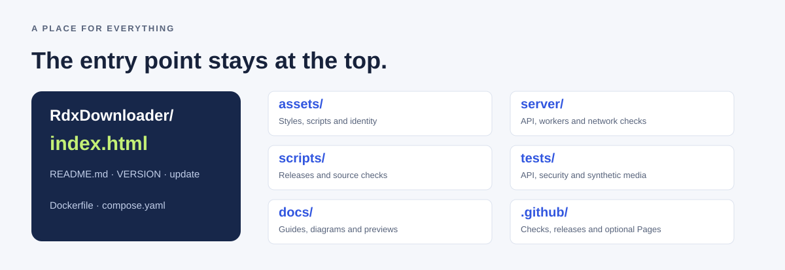

```text
RdxDownloader/
├── index.html                 # Main website entry point stays at the root
├── README.md                  # This illustrated project guide
├── VERSION                    # Current release 1.0.1
├── update                     # Safe Bash release entry point
├── ads.txt                    # Add actual provider-issued authorization
├── robots.txt
├── Dockerfile
├── compose.yaml
├── requirements.txt
├── .env.example               # Server settings; private .env is ignored
├── assets/
│   ├── css/style.css
│   ├── images/mark.svg
│   └── js/
│       ├── app.js             # Inspect → select → prepare → save
│       ├── config.js          # Public backend origin
│       ├── ads.js             # Manual/consent-aware ad loader
│       └── ads-config.js      # Public approved ad IDs only
├── server/
│   ├── app.py                 # Bounded HTTP API, temporary jobs and static allowlist
│   ├── worker.py              # Disposable extraction/download process
│   └── network.py             # Public IP/DNS/socket checks
├── scripts/
│   ├── release.py             # Non-destructive version/tag/push helper
│   └── check_project.py
├── tests/                     # API/security/merge tests + intercepted browser fixtures
├── docs/                      # Deployment, ads, architecture, releases and visuals
└── .github/workflows/         # Checks, release ZIP and optional frontend-only Pages
```

## ↗ Versions that start fresh

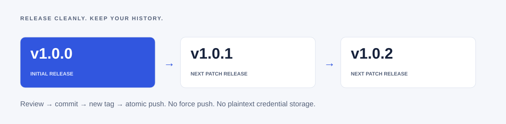

```bash
./update --dry-run             # Does not change files, fetch, commit, tag or push
./update                       # Review changes; type RELEASE to publish
# Without Bash:
python scripts/release.py
```

The initial release was **v1.0.0**; this complete update is **v1.0.1**, followed by **v1.0.2** … Standard semantic patch increments are used. No old project tags are included. The helper targets **Hriduan/RdxDownloader**, refuses unrelated origins and safely publishes ZIP imports/divergent local histories from a reviewed fresh remote-main clone, and does **not** force-push, replace tags, or save credentials in plaintext.

The GitHub release workflow creates a source ZIP on new version tags. Backend deployment is separate. [Release behavior and recovery →](docs/RELEASING.md)

## ⛨ Useful safeguards, honest boundaries

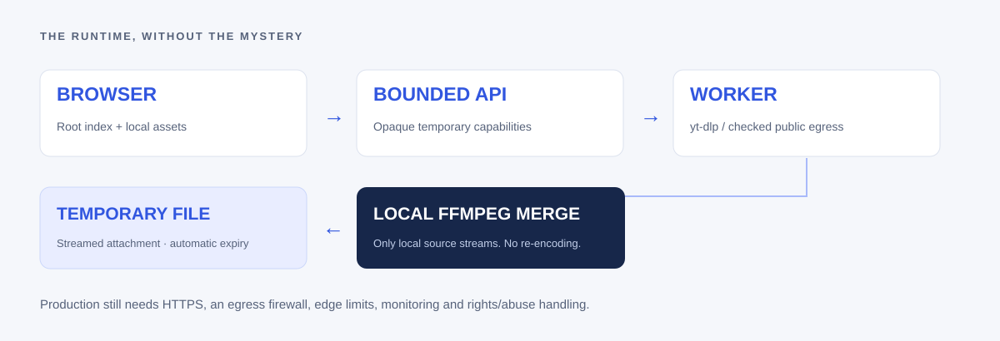

- Public HTTP(S) URLs only; no user credentials, session cookies, custom ports or internal network links.
- Socket-boundary public-IP checks in disposable workers, plus disabled inherited proxies and remote FFmpeg fetching.
- Server-generated paths, temporary opaque capabilities, route allowlisting and no public download directory listings.
- Bounded workers, queue, HTTP handler count, source duration, file size, temporary disk usage and job runtime.
- No DRM bypass, private-account extraction, paywall unlocking, upscaling or source watermark removal.
- A host firewall/egress policy, HTTPS, DNS isolation, dependency maintenance and edge abuse controls are still required. This starter has **not** been penetration-tested.
- One backend process/replica only. Restarting it invalidates in-memory metadata/job links.
- Operators must add a monitored privacy/copyright/abuse contact and comply with applicable platform, advertising and local legal requirements.

The Linux Docker build now installs **Deno + the matching bundled yt-dlp-ejs solver**. Native Termux uses its official Deno package. Deno executes bundled solver code in its sandbox; remote component downloads and insecure Node/Bun fallback are not enabled. This improves YouTube compatibility but does not unlock restricted content or guarantee every link. Run `python scripts/doctor.py --strict` on the backend host.

## ◇ Setup, without guessing

<table>
<tr><td>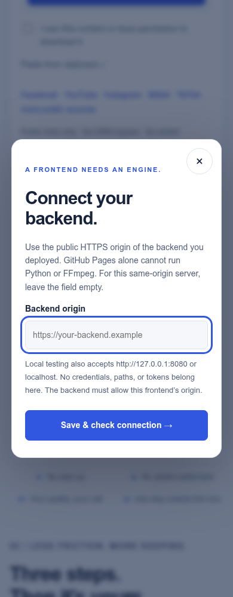</td><td>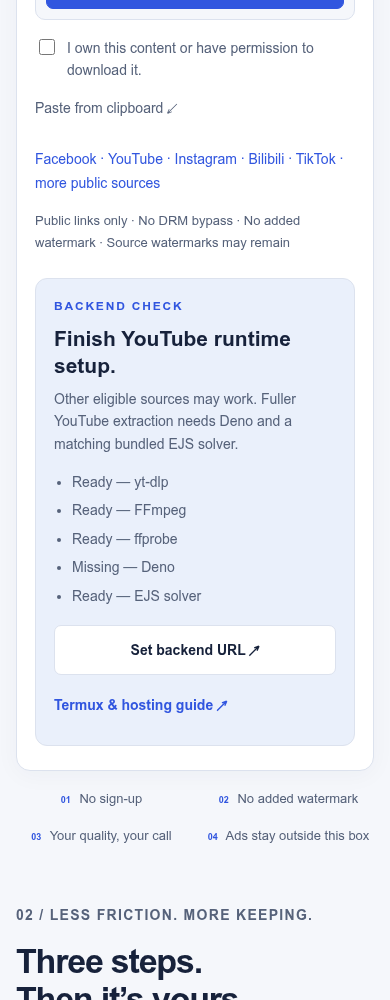</td></tr>
<tr><td align="center">Connect the engine.</td><td align="center">See what is missing.</td></tr>
</table>

## ✓ Check your changes

```bash
python -m unittest discover -s tests -p 'test_*.py' -v
python scripts/check_project.py
node --check assets/js/app.js
node --check assets/js/ads.js
python scripts/doctor.py --strict
```

Optional browser fixtures require Playwright and Chromium. Start the local backend on port 8091, then:

```bash
# Development-only tooling; not a website runtime dependency:
npm install --no-save playwright
PORT=8091 python -m server.app
# In another terminal:
CHROMIUM_PATH=/path/to/chromium node tests/browser.cjs
CHROMIUM_PATH=/path/to/chromium node tests/ads.cjs
```

The platform-routing tests exercise Facebook, YouTube, Instagram, Bilibili and TikTok URL patterns without contacting those sources.

The synthetic media integration test generates its own one-second color/tone clip, then verifies **640×360 video plus an audio track** after real yt-dlp/FFmpeg merging. It bypasses network guards only for its own loopback test fixture, not in production code. Browser tests use simulated source catalogs/jobs; **no real third-party videos, ad impressions or ad clicks** are generated.

See [UI-QA.json](docs/UI-QA.json) and [AD-QA.json](docs/AD-QA.json) for the browser runs. Tests do not establish real-world platform availability, actual provider fill or legal compliance.

## ▤ Design notes

Blue for action. Lime for emphasis. Generous negative space. An original download-mark identity. Dark mode that respects your system. All README artwork and diagrams are local assets; screenshots are from this project. No external badge service or stock image dependency is required to read the visual guide.

<table>
<tr><td>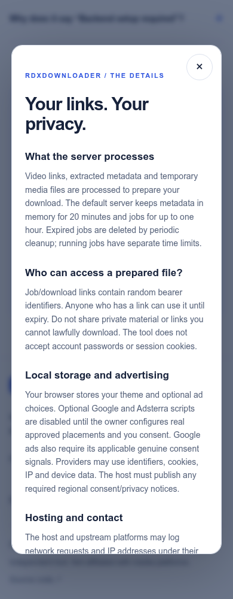</td><td>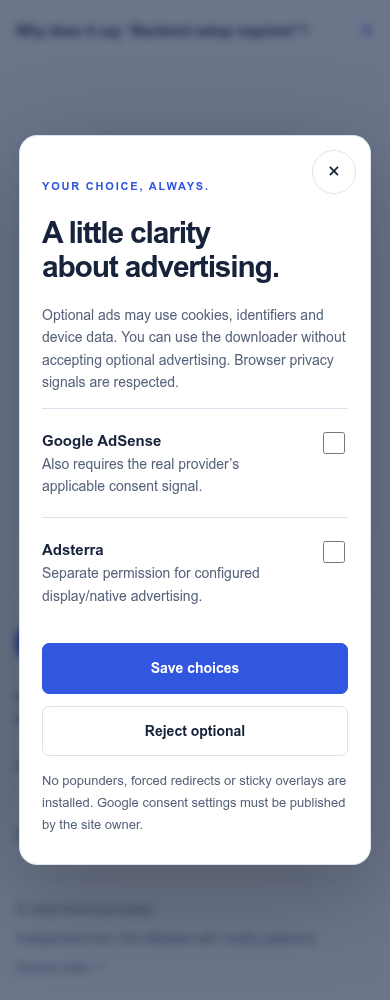</td><td>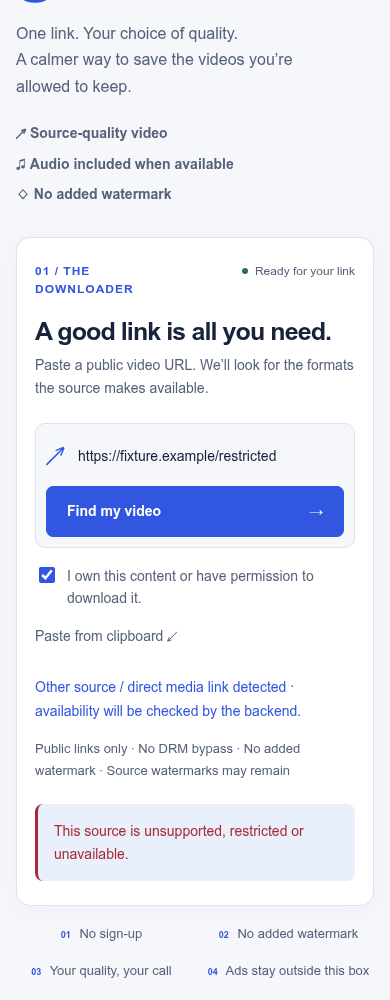</td></tr>
<tr><td align="center">Clear privacy.</td><td align="center">Real choice.</td><td align="center">Honest failure.</td></tr>
</table>

---

<div align="center">


**Keep the good stuff. Respect the original.**

[Source](https://github.com/Hriduan/RdxDownloader) · [Security](SECURITY.md) · [Changelog](CHANGELOG.md) · [MIT project license](LICENSE)

Independent project. Not affiliated with the platforms it can process.<br>Third-party software and source media retain their own rights and licenses.
</div>
